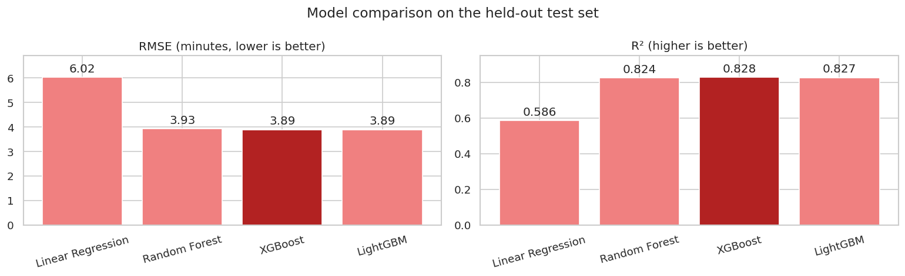
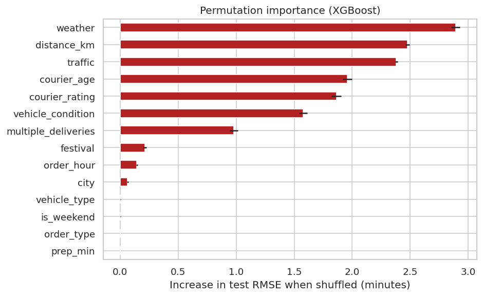

# Food Delivery Time Prediction

Predicts how many minutes a food delivery will take from courier, order, location, weather and traffic details. Four regression models are compared, and the best one is packaged as a scikit-learn pipeline with a command-line tool that takes raw order data and returns a predicted delivery time.

**Best model:** XGBoost — test RMSE **3.89 min**, MAE **3.11 min**, R² **0.83**. 82% of test orders are predicted within 5 minutes of the actual time.

## Results

Scores on a held-out 20% test set (9,119 orders) that was never used for tuning or model selection:

| Model | CV RMSE | Test RMSE | Test MAE | Test R² |
|---|---|---|---|---|
| Linear Regression (baseline) | 6.07 | 6.02 | 4.79 | 0.586 |
| Random Forest | 3.94 | 3.93 | 3.14 | 0.824 |
| **XGBoost** (selected) | **3.89** | **3.89** | **3.11** | **0.828** |
| LightGBM | 3.92 | 3.89 | 3.11 | 0.827 |

The model is selected by cross-validated RMSE on the training set, not by test score. Cross-validated and test scores agree closely, so the evaluation is sound.



The most important factors are weather, distance and traffic, followed by the courier's age and rating and the vehicle's condition. Preparation time, order type and vehicle type contribute almost nothing.



## Quick start

```bash
pip install -r requirements.txt

# Train the models and save the best pipeline to models/model.joblib (under 30 seconds)
python train.py

# Predict for orders in a CSV with the Kaggle column layout
python predict.py --csv data/train.csv --limit 5

# Predict a single order
python predict.py --age 29 --rating 4.7 \
    --restaurant 12.9141,77.6782 --destination 12.9441,77.7082 \
    --order-time 19:30 --pickup-time 19:45 --date 2022-03-12 \
    --weather Stormy --traffic Jam --multiple-deliveries 1 --city Metropolitian
```

Output:

```
Predicted delivery time: 21 minutes
```

`python predict.py --help` lists every option. Fields left out are filled in the same way as missing values during training. Use `--output predictions.csv` with `--csv` to save the predictions as a new column.

`python train.py --tune` re-runs the hyperparameter search (randomized search with 3-fold cross-validation, about 6 minutes) and updates `params.json`. Without `--tune` it uses the saved parameters.

The notebook `food_delivery.ipynb` walks through the data cleaning, exploratory analysis, model comparison, residuals and feature importance.

## How it works

**Cleaning.** The raw data stores missing values as the text `"NaN"`, pads values with spaces, and keeps the target as text like `"(min) 24"`. Ratings above 5 (53 rows) are treated as missing, and coordinates with a flipped sign are corrected.

**Features.**
- `distance_km`: great-circle distance between restaurant and delivery location
- `prep_min`: minutes between the order being placed and picked up, correct across midnight
- `order_hour`, `is_weekend`
- Courier age and rating, vehicle condition and type, multiple deliveries, weather, traffic, order type, festival, city type

**Pipelines.** Each model is a scikit-learn `Pipeline` in which imputation and encoding are fitted on the training data only. Traffic is encoded in its natural order (Low < Medium < High < Jam). Because the saved pipeline contains every preprocessing step, `predict.py` can take raw data directly.

## What I fixed from the first version

This project started as a notebook that I later reviewed and rebuilt. The main problems were:

1. **The test set was scaled with its own statistics.** The scaler was fitted separately on the test data (`fit_transform` instead of `transform`), so training and test features were transformed differently. This is likely why XGBoost looked fine in cross-validation but poorly on the test set.
2. **Features were chosen using the test set.** The "top 7 features" analysis scored each subset on the test data, which makes the test score optimistic. The same code also passed the arguments to `r2_score` in the wrong order.
3. **Imputation and encoding were fitted on the full dataset** before the train/test split, leaking a little test information into training. They now live inside the pipeline.
4. **The saved models could not be used.** The encoder and scaler were never saved, so the prediction script passed raw data to models that expected transformed data, and it crashed. The pipeline now bundles all preprocessing. The Random Forest pickle was also 86 MB; models are now regenerated with `train.py` and kept out of git.
5. **Smaller issues:** invalid ratings of 6 were used as real values, `year_quarter` had the same value in every row, the preparation-time formula was only correct for gaps under an hour (harmless on this data, where every gap is 5–15 minutes), and the README listed models the notebook never used.

After the fixes, the tuned models' accuracy is close to the original best (the original Random Forest reached a cross-validated RMSE of about 3.93). The difference is that the scores can now be trusted, and XGBoost improved from 4.35 to 3.89 once evaluated correctly.

## Project structure

```
├── delivery_time/
│   ├── features.py      # cleaning and feature engineering (no fitted state)
│   └── modeling.py      # pipelines, search spaces, evaluation
├── train.py             # train, compare and save the best pipeline
├── predict.py           # predict from a CSV or from command-line arguments
├── food_delivery.ipynb  # analysis notebook
├── params.json          # tuned hyperparameters
├── results.json         # latest training results
├── data/train.csv       # Kaggle training data
└── assets/              # charts used in this README
```

## Data

[Food Delivery Dataset](https://www.kaggle.com/datasets/gauravmalik26/food-delivery-dataset) by Gaurav Malik on Kaggle: 45,593 orders from Indian cities in March 2022. Only `train.csv` is used, because the Kaggle test file has no delivery times.

## License

MIT — see [LICENSE](LICENSE).
